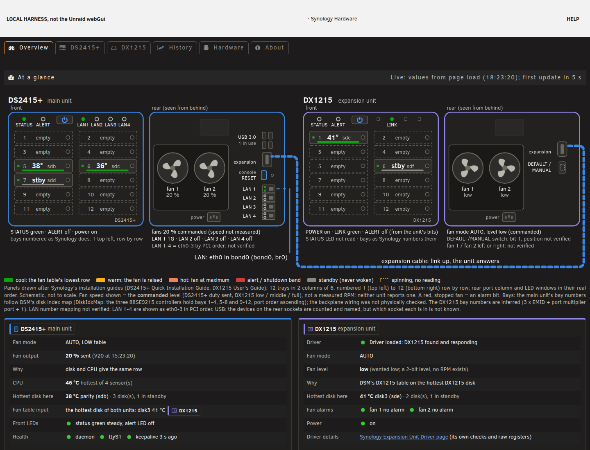
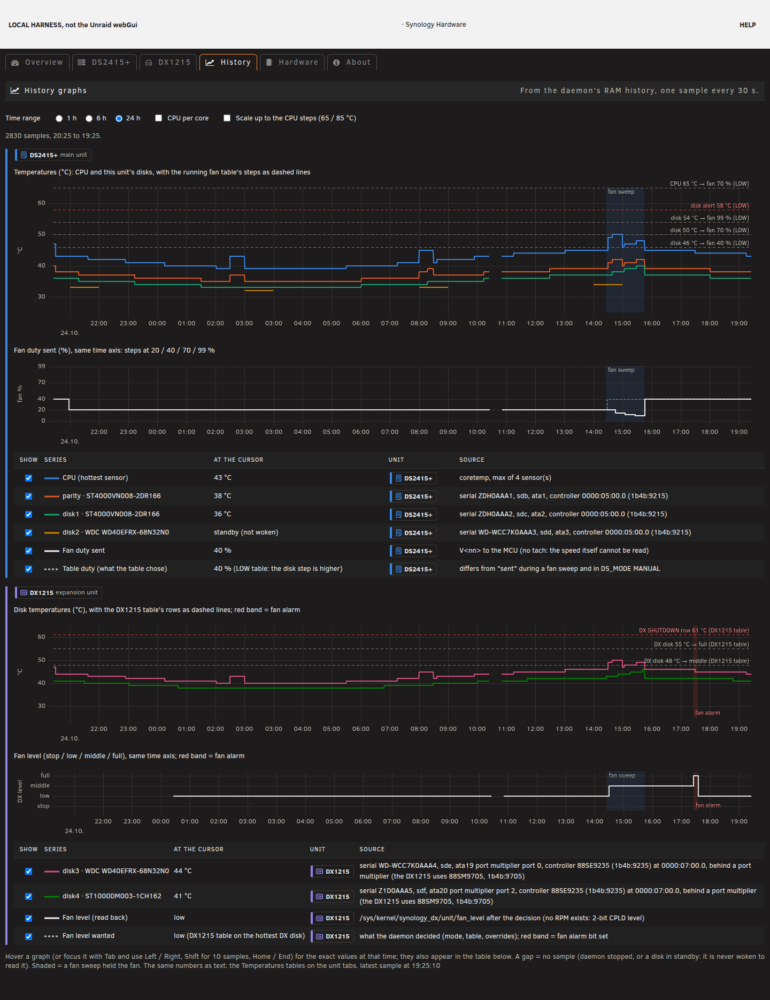

# Synology Hardware: an Unraid plugin for the Synology DS2415+ (and DX1215)

This plugin exists because of **[synodeb](https://github.com/rylos/synodeb)**: it showed
that a Synology NAS can run a plain Linux with all its hardware working, and it is the way
to get another system booting on the box in the first place. Start there.

Once Unraid runs, this plugin and its companion, the
[Synology Expansion Unit Driver](https://github.com/luuvasara/unraid-synology-expansion), add the
Synology hardware support that Unraid does not have. They are maintained and hosted here;
they are not part of synodeb.

Status: experimental. Developed and tested on one DS2415+ (Intel Atom C2538) with one DX1215
expansion unit, Unraid 7.3.4 (kernel 6.18.58-Unraid). Other models are not supported; the
Report tab exists to collect what other units look like.

## What it does

| | |
|---|---|
| Fans of the DS2415+ | through the front-panel microcontroller (`ttyS1`, ASCII bytes measured under DSM): DSM's own fan tables (LOW or HIGH), duty from the hottest disk and the CPU, sleeping disks are never woken; manual mode with a floor |
| LEDs | power and status LEDs; status orange and the alert LED in DSM's alert band; orange bay LEDs from disk health (with the expansion driver) |
| Safety | an allow-list: the power-off (`1`), reset (`C`) and long-beep (`3`) bytes are never sent, the fan is never set below 10 % |
| MAC addresses | the onboard NICs come up with Intel's placeholder MAC under any OS but DSM; the plugin reads the real MACs from the DOM, read-only, and applies them at boot (udev rule on the flash) |
| DX1215 fans | through the Expansion Unit Driver: DSM's DX1215 table (low/middle/full) on the DX1215 disks, full on a fan alarm, never stop |
| Settings page | Settings, Synology Hardware: tabs for both units with a live front/rear drawing and bay map, temperatures, history graphs, a hardware inventory, known issues and firmware versions; bay badges on the Main page |
| Report | a read-only collector whose output is anonymised on the server (serials, MACs, WWNs, UUIDs, labels, hostname, IPs, user names become placeholders) and can be copied, downloaded or opened as a GitHub issue here |

## Supported hardware

| Model | State |
|---|---|
| DS2415+ (Intel Atom C2538) | tested: fans, LEDs, MACs, bay map, inventory |
| DX1215 expansion unit | tested, through the Synology Expansion Unit Driver plugin |
| other C2538 units (DS415+, DS1515+, DS1815+, RS815(RP)+, RS2416(RP)+) | not supported yet; please send a report from the Report tab |

### Known limits

- The DX1215 makes the stock Unraid kernel wait about 200 s at boot (a port multiplier quirk
  Unraid's kernel does not have). `libata.force=19.05:norst,20.05:norst,21.05:norst,22.05:norst`
  on the Unraid command line halves it (port numbers per unit, from `dmesg`).
- Power button, fan speeds (the fans have no tachometer) and the meaning of some
  microcontroller bytes are not known yet.
- Stock DS2415+ RAM is 2 GB; Unraid runs from RAM.

## Screenshots

Taken in the offline test harness (`tests/harness/`) with the test fixtures, not on a real server.

Overview tab: live front and rear drawing of both units, fan state per unit.

History tab: temperatures and fan duty on one time axis, per unit.

## Roadmap

The aim is to become a backend for the FanCtrl Plus plugin: the DS2415+ and DX1215 fans as
standard hwmon `pwm` devices, with this project's safety floor kept, so fan curves live in
FanCtrl Plus instead of in yet another fan-control page. Not implemented yet; until then the
plugin's own fan modes are used.

## Install

Unraid webGui: **Plugins, Install Plugin**, paste

    https://raw.githubusercontent.com/luuvasara/unraid-synology-hardware/main/synology-hardware.plg

or on the console: `plugin install https://raw.githubusercontent.com/luuvasara/unraid-synology-hardware/main/synology-hardware.plg`.
Install the [Synology Expansion Unit Driver](https://github.com/luuvasara/unraid-synology-expansion)
too if a DX1215 is attached (and for the bay LEDs).

The package (`packages/synology-hardware-<version>-x86_64-1.txz`) is downloaded from this
repository and checked against the MD5 in the `.plg`. Updates show up in Unraid's plugin
update check, because the `.plg` carries its `pluginURL`. Settings are kept on the flash at
`/boot/config/plugins/synology-hardware/synology-hardware.cfg` across updates and removal.

On the first install the network drops for a few seconds while the real MACs are applied
(skipped while Docker or VMs run; the next boot does it then). The DHCP address may change
with the MAC.

## Build from source

Needs bash, PHP (CLI), Python 3, xz; Node.js for the JS syntax check (optional).

    ./tests/run-tests.sh      # offline, touches no NAS and no real tty
    ./build.sh                # version comes from synology-hardware.plg; bump it on every change

`build.sh` builds `packages/synology-hardware-<version>-x86_64-1.txz` (file modes forced, archive
root checked, owner root, PHP and JS linted), writes the package MD5 into the `.plg` and regenerates
`CHANGELOG.md` from the `.plg`'s `<CHANGES>`. Build on a workstation, never on the NAS.

### Repository layout

| path | what |
|---|---|
| `synology-hardware.plg` | the plugin manifest (version, pluginURL, package URL + MD5, install/remove scripts, CHANGES) |
| `packages/` | the built package of the version in the `.plg` and its `.md5` |
| `src/` | the package contents, laid out as on the server (`usr/local/emhttp/plugins/synology-hardware/`, `etc/rc.d/`) |
| `CHANGELOG.md` | generated by `build.sh` from the `.plg`'s `<CHANGES>` |
| `docs/screenshots/` | screenshots for this README |
| `build.sh` | builds the package (never on a NAS): modes forced, archive root checked, PHP and JS linted, MD5 written into the `.plg` |
| `tests/` | offline tests: `tests/run-tests.sh` (fake sysfs and syslog, a pty acting as the microcontroller, mutation checks); the fixtures use fake serials, MACs and IPs |
| `.github/ISSUE_TEMPLATE/hardware-report.yml` | the form the Report tab opens |

Comments and help texts cite `research/...` and `experiments/...` notes: those are the
measurement notes of the development repository and are not published here.

### How this repository is kept in sync

Development happens in a private repository (it holds the hardware captures this plugin was
measured from, which are not publishable). This repository is an export of the plugin tree
only: `src/`, `tests/`, `build.sh`, the `.plg`, `CHANGELOG.md`, `docs/`, `.github/`, this README and
the package of the current version are copied file for file by an export script at each release, then committed
here. Nothing is edited only here; a change made here (for example from a pull request) is
applied to the private tree first and comes back with the next export. The history of this
repository starts at its first export (2026-10-26).

## Credits and upstream

- **[synodeb](https://github.com/rylos/synodeb)** (GPL-2.0) by rylos: Debian on Synology hardware with
  everything working. It is the inspiration for this plugin and the way to get another system booting on
  the box in the first place. The serial settings of the front-panel microcontroller and parts of the
  hardware knowledge come from synodeb's DS923+ code (cited as "DS923+ code" on the About tab); no
  synodeb code is copied into this repository.
- Booting Unraid on a DS2415+ needs synodeb's stage-1 kexec boot chain, which is proposed upstream but
  not part of synodeb as released yet. Until (or unless) it lands, our fork has it:
  https://github.com/luuvasara/synodeb. The worked example "Unraid from a USB stick through stage-1"
  there (branch `boot/06-docs-unraid-example`, `docs/stage1-unraid.md`) shows the `stage2.conf` for an
  Unraid stick.
- The companion [Synology Expansion Unit Driver](https://github.com/luuvasara/unraid-synology-expansion)
  plugin carries the `synology_dx` kernel module (source and build script in that repository).
- [uPlot](https://github.com/leeoniya/uPlot) 1.6.32 (MIT) by Leon Sorokin, vendored under
  `src/usr/local/emhttp/plugins/synology-hardware/vendor/uplot-1.6.32/` with its LICENSE.

Unraid is a trademark of Lime Technology. Synology, DiskStation and DSM are trademarks of
Synology Inc. This project is not affiliated with either.

## License

GPL-2.0, see [LICENSE](LICENSE), the same as synodeb. uPlot is under its own MIT license
(`src/usr/local/emhttp/plugins/synology-hardware/vendor/uplot-1.6.32/LICENSE`).
